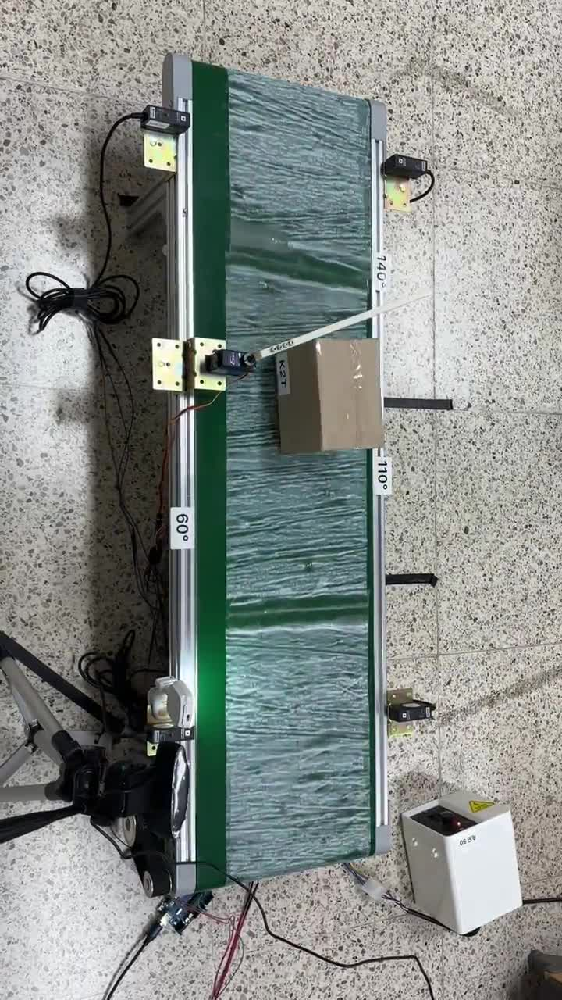
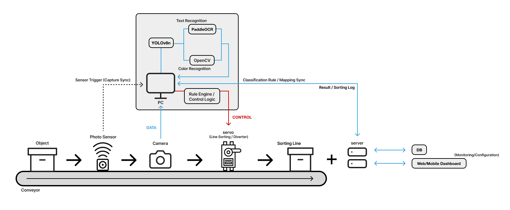
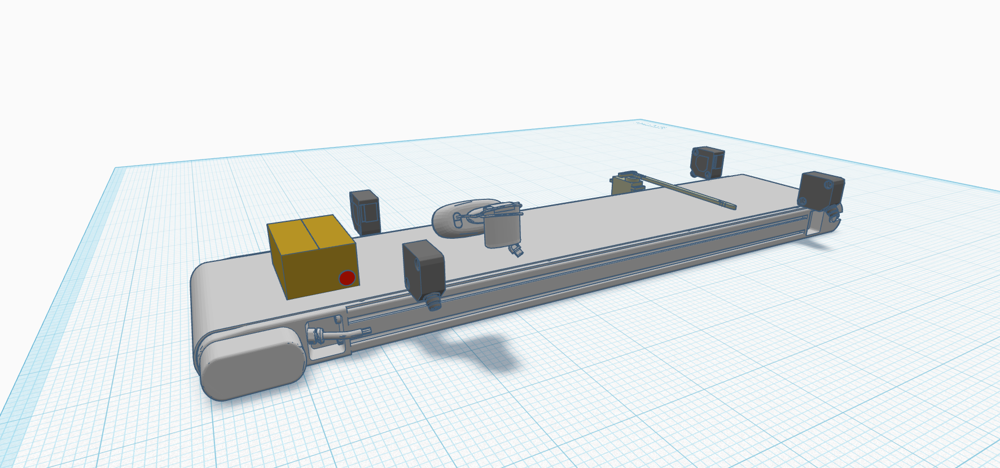
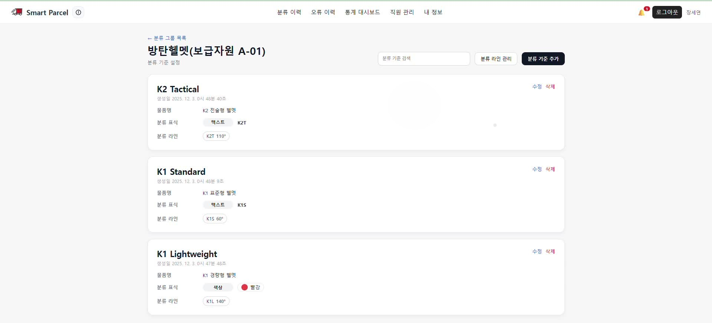
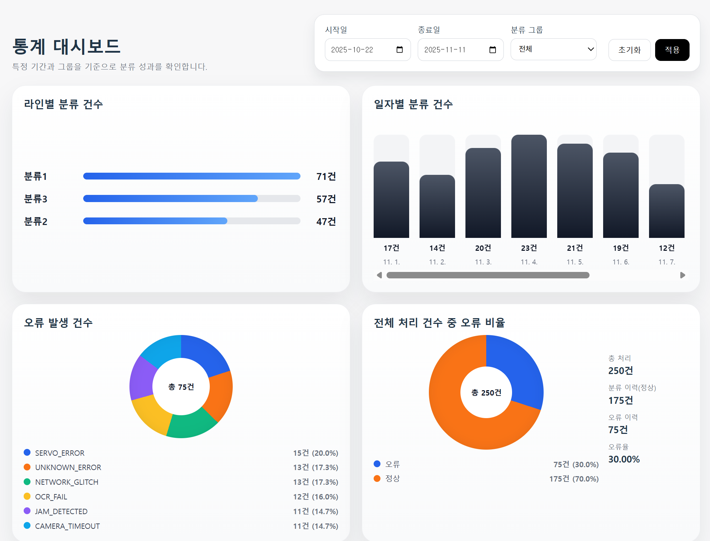
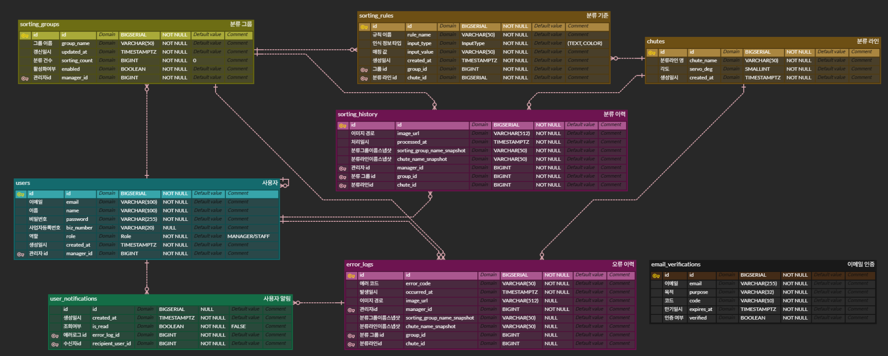

# 📦 SmartParcel — AI·하드웨어 융합 소형 자동 분류 시스템

> **2025-2 창의융합종합설계 · 3인 팀 프로젝트**  
> 카메라 인식, 동적 분류 규칙, Arduino 물리 제어 및 웹·모바일 모니터링을 연결한 **Physical AI 기반 자동 분류 프로토타입**

---

## 🔗 Repository Guide

| 저장소 | 담당 범위 | 링크 |
| --- | --- | --- |
| **통합 안내 (현재 저장소)** | 프로젝트 전체 아키텍처·성과·시연·문서 | [smart-sort](https://github.com/yoniyon03/smart-sort) |
| **AI 비전** | YOLOv8n, PaddleOCR, OpenCV, 분류 인식 파이프라인 | [smart-sort-ai](https://github.com/yoniyon03/smart-sort-ai) |
| **웹 대시보드** | React 기반 운영 화면 및 관련 서버·DB 구조 안내 | [smart-sort-web](https://github.com/yoniyon03/smart-sort-web) |
| **Arduino** | 센서 입력, 서보모터 제어, PC–Arduino 시리얼 통신 | [smart-sort-arduino](https://github.com/yoniyon03/smart-sort-arduino) |

> Spring Boot API 서버는 프로젝트 백엔드 구성요소이며, 위 저장소 목록에는 **백엔드 전용 저장소 링크가 별도로 포함되어 있지 않습니다.**

---

## 🎯 Project Overview

**SmartParcel**은 고가의 고정형 자동화 설비를 설치하기 어려운 **소규모·임시 물류 및 군수·재난 대응 환경**을 대상으로 한 소형 분류 시스템입니다. 작업자는 웹·모바일 대시보드에서 텍스트 또는 색상 표식과 분류 라인 간 매핑을 설정하고, 장비는 촬영한 물체의 표식을 인식해 지정된 방향으로 자동 분기합니다.

초기 기획은 택배 라벨의 우편번호·지역코드 인식에 초점을 두었으나, **최종 구현에서는 현장별로 달라지는 물품 분류 기준에 대응하기 위해 텍스트/색상 표식과 Rule Mapping 구조로 범위를 변경**했습니다.

| 항목 | 내용 |
| --- | --- |
| 프로젝트명 | SmartParcel / AI·하드웨어 융합 소형 자동 분류 시스템 |
| 개발 기간 | 2025.09.03 ~ 2025.12.12 |
| 형태 | 창의융합종합설계 · 팀 프로젝트 (3명) |
| 참여 | 박진호 · 김나영 · 장세연 |
| 핵심 가치 | 저비용·소형화, 가변적인 분류 기준, 인지–판단–행동 통합 |
| 구현 범위 | AI Vision · Arduino/센서/서보 · Spring Boot API/DB · React/Flutter 관리 UI |

---

## ✨ Key Features

| 영역 | 구현 내용 |
| --- | --- |
| **물체·표식 감지** | YOLOv8n으로 `objects`, `marker_text`, `marker_color` 영역 탐지 |
| **텍스트 인식** | PaddleOCR, 각도별 재시도·전처리, 인식 신뢰도 기반 처리 |
| **색상 인식** | OpenCV HSV 변환 및 대표 색상 분석 |
| **동적 분류 규칙** | 관리자가 설정한 텍스트/색상 → 분류 라인·서보 각도 매핑 조회 |
| **물리 제어** | 전방 센서 감지, 촬영 트리거, Arduino 시리얼 통신, 서보 분기, 후방 검수 |
| **운영 관리** | 분류·오류 이력, 통계, 규칙/그룹 관리, 알림, 관리자/직원 권한 관리 |

---

## 🧭 System Architecture

**End-to-End 흐름**

1. **Sensing:** 전방 포토센서가 물체 도착을 감지하고 캡처 절차를 시작합니다.
2. **Recognition:** 카메라 이미지에서 YOLOv8n으로 표식 영역을 검출하고 텍스트는 PaddleOCR, 색상은 OpenCV/HSV로 분석합니다.
3. **Decision:** API 서버에서 동적으로 제공하는 분류 규칙과 인식 결과를 매칭하여 분류 라인 및 제어 각도를 결정합니다.
4. **Action:** PC–Arduino 시리얼 통신으로 서보모터를 구동해 물체를 해당 슈트로 분기합니다.
5. **Verification & Monitoring:** 후방 검수 센서 및 결과/오류 로그를 통해 처리 상태를 기록하고 대시보드에서 조회합니다.

**구성 요소:** Python AI Vision / Arduino Uno / Spring Boot API / PostgreSQL / Redis / React·Flutter. 서버가 규칙과 데이터를 관리하며, 비전 프로세스와 MCU가 센싱·인식·제어를 수행합니다.

---

## 🛠 Tech Stack

**AI & Vision**  
    

**Backend & Data**  
   

**UI & Embedded**  
   

**Cloud:** Azure App Service · Azure Static Web Apps · Azure Database for PostgreSQL · Azure Cache for Redis

---

## 🖼️ Implementation & Demonstration

### 실물 프로토타입 및 설계

| 실제 분류 장치 | 컨베이어 구조 3D 설계 |
| :---: | :---: |
|  |  |

### 운영 대시보드

| 최종 시연 화면 | 대시보드 화면 설계 자료 |
| :---: | :---: |
|  |  |

> `web_demo.jpg`는 **최종 시연 영상에서 추출한 실제 화면**, `dashboard.png`는 제공된 **UI 설계 자료**입니다.

### 데이터 모델

- `users`, `email_verifications`: 계정·이메일 인증
- `sorting_groups`, `sorting_rules`, `chutes`: 활성 그룹 및 매핑 기준
- `sorting_history`, `error_logs`, `user_notifications`: 분류/오류 이력과 알림

---

## 🎬 실제 자동 분류 시연 (Demonstration)

카메라 기반 표식 인식, 분류 규칙 매핑, 서보모터 제어를 연계하여 실제 컨베이어에서 물품을 자동 분류하는 과정을 확인할 수 있습니다.

## 🎬 실제 자동 분류 시연 (Demonstration)

웹 대시보드에서 텍스트 및 색상 표식에 따른 **분류 규칙(Rule Mapping)과 서보모터 동작 각도를 사전에 설정**한 뒤, 실제 컨베이어 환경에서 자동 분류를 테스트했습니다.

카메라로 물품의 표식을 인식하고, 설정된 분류 규칙에 따라 서보모터를 제어하여 해당 분류 라인으로 물품을 이동시키는 과정을 확인할 수 있습니다.

### 최종 분류 시연 영상

| 구분 | 인식 대상 | 사전 설정된 서보모터 각도 | 시연 영상 |
| :---: | :---: | :---: | :---: |
| 시연 1 | 텍스트 라벨 `K2T` | **110°** | [▶ 영상 보기](videos/sorting_demo_1.mp4) |
| 시연 2 | 텍스트 라벨 `K1S` | **60°** | [▶ 영상 보기](videos/sorting_demo_2.mp4) |
| 시연 3 | 빨간색 스티커 `RED` | **140°** | [▶ 영상 보기](videos/sorting_demo_3.mp4) |

### 분류 처리 흐름

1. **규칙 설정:** 웹 대시보드에서 각 텍스트·색상 표식에 대한 분류 규칙 및 서보모터 각도를 사전 설정
2. **표식 인식:** YOLOv8n으로 표식 영역을 탐지한 후, 텍스트는 PaddleOCR, 색상은 OpenCV 기반 HSV 분석으로 인식
3. **규칙 매핑:** 인식된 결과를 서버에 등록된 분류 규칙과 매칭하여 분류 라인 및 제어 각도 결정
4. **하드웨어 제어:** 결정된 각도를 기반으로 Arduino가 서보모터를 구동하여 물품 분류
5. **결과 기록:** 분류 결과 및 관련 이력을 서버에 저장하고 웹 대시보드에서 조회

### 실제 구동 장면

> 시연 영상은 컨베이어와 분류 장치의 실제 구동을 보여줍니다. 개별 영상의 분류 유형은 제목만으로 특정하지 않았습니다.

---

## 📊 Evaluation Results

**최종 결과보고서에 기록된 시험 결과**입니다. AI 단독 검증과 전체 하드웨어 분류 시험은 서로 다른 지표입니다.

| 측정 항목 | 결과 | 측정 범위 |
| --- | ---: | --- |
| YOLOv8n mAP@0.5 | 약 **0.95** | 검증 데이터셋 객체 탐지 |
| YOLOv8n mAP@0.5:0.95 | 약 **0.75** | 검증 데이터셋 객체 탐지 |
| OCR 문자열 전체 일치율 | **100% (100/100)** | K1S/K2T 라벨 이미지 100장 |
| **전체 분류 성공률** | **95.7% (287/300)** | 실제 컨베이어·센서·모터를 포함한 반복 시험 |
| End-to-End 평균 처리 시간 | **4.78초** | 카메라 인식부터 서버·서보 동작까지 (최종보고서 수치) |
| API 부하 시험 | **1,685/1,685 요청 성공** | k6, 50 VU, 1분, 평균 1.69초·p95 3.87초 |

> 성공률 95.7%는 실제 시험 조건에서의 결과이며 상용·군수 현장 일반 성능을 의미하지 않습니다.

---

## 👥 Team & My Contributions

| 담당 | 주요 책임 |
| --- | --- |
| **장세연 — Embedded / 시스템 설계·리딩** | 하드웨어 설계·제작, Arduino 센서/서보 제어, Python–Arduino 시리얼 프로토콜, End-to-End 통합 설계, Figma UI/UX, 일정·문서 관리 |
| **김나영 — AI Vision** | 이미지 수집·라벨링, YOLOv8n 전이학습, PaddleOCR·OpenCV 인식, AI 파이프라인 및 하드웨어 연동 시험 |
| **박진호 — Web/App & Backend** | Spring Boot API, React/Flutter UI, 인증·권한, PostgreSQL/Redis, Azure 배포·운영 기능 |

### 장세연 — 담당 구현 및 기여

- **임베디드 설계:** 장비 선정, 센서·서보·전원/배선 구성, 컨베이어 기구 통합, 커스텀 서보혼 설계·제작
- **Arduino 제어:** 센서 디바운싱, 감지·검수 상태 추적, 서보 제어 및 제어 피드백
- **통신·통합:** Python–Arduino 양방향 시리얼 명령(`HOME`, `SERVO`, `PING` 등) 정의, 촬영–인식–분류–검수 흐름 및 타이밍 조정
- **서비스 설계:** 웹·모바일 화면 구조 및 기능 흐름을 Figma로 설계, 분류 규칙 운영 UX 구체화
- **프로젝트 관리:** 아키텍처/도메인 재정립, 팀 조율, 일정·기자재·문서 관리
- **협업:** AI 학습 데이터 촬영·라벨링 보조 및 AI/서버 담당자와의 인터페이스 연동 검증

> 최종 결과보고서는 장세연을 RISE 사업단 주관 캡스톤디자인의 팀장으로 기록합니다. 표지상 문서 제출 책임자(박진호)와는 구분되는 역할입니다.

---

## 🧩 Engineering Challenges

**1. 센서 신호 및 전원 안정화:** 산업용 포토센서 신호를 Arduino와 연동하는 과정에서 노이즈·오검출과 전원 이슈를 점검하고, 디바운싱과 감지·검수 센서 분리 및 외부 전원 구성으로 안정화를 시도했습니다.

**2. 물리적 분기 동작:** 서보혼의 짧은 유효 길이와 물체 마찰 때문에 분류가 불안정해지는 문제를 경험했습니다. 커스텀 서보혼과 킥 모션, 센서·카메라·서보 타이밍 조정을 적용했습니다.

**3. 환경 변화에 강한 인식:** 물체 이동 중 모션 블러 및 조명·각도 변화에 대응해 다중 프레임 선명도 선택, multi-angle OCR, HSV 기반 색상 처리를 적용했습니다.

**4. 현장 규칙 변경:** 인식값을 소스코드에 고정하기보다 서버의 분류 규칙/라인 매핑을 받아 실행 중 변경된 운영 기준에 대응하도록 설계했습니다.

---

## ⚠️ Limitations & Next Steps

- 처리 시간은 컨베이어 속도·센서 위치·OCR 재시도·서보 동작에 영향을 받으며, 현재 **연속 고속 처리용 상용 소터** 수준은 아닙니다.
- 조명 반사, 기울어진 표식, 물체의 크기·마찰력에 따라 인식 및 분기 실패 가능성이 있습니다.
- k6 시험은 주어진 **Azure 학생용/기본 티어**에서의 단기 부하 결과입니다. 운영 환경 확대 시 조회·집계 API 최적화가 필요합니다.
- 실제 군수/재난 현장에서의 장기 운용 검증이 아니라 **소형 실증 프로토타입**입니다.

---

## 📚 개발 문서 및 모듈별 README (Documentation & Modules)

### 📄 개발 문서

프로젝트의 기획부터 요구사항 분석, 시스템 설계, 최종 구현 및 검증까지의 개발 과정을 정리한 문서입니다.

| 문서 | 주요 내용 |
| --- | --- |
| [주제제안서](docs/proposal.pdf) | 프로젝트 추진 배경, 문제 정의, 개발 목표 및 초기 시스템 구상 |
| [요구명세서](docs/requirements.pdf) | 기능·비기능 요구사항, 유스케이스 및 시스템 제약조건 |
| [설계명세서](docs/system-design.pdf) | 시스템 구조, 데이터베이스 설계, UI 설계 및 주요 기능별 동작 흐름 |
| [최종 결과보고서](docs/final-report.pdf) | 최종 구현 내용, 시스템 통합 과정, 성능 평가 및 프로젝트 결과 |

### 🔗 모듈별 저장소

| 모듈 | 저장소 | 주요 역할 |
| --- | --- | --- |
| AI 비전 | [smart-sort-ai](https://github.com/yoniyon03/smart-sort-ai) | YOLOv8 기반 객체 탐지, PaddleOCR 및 OpenCV 색상 인식 |
| 웹 대시보드·서버 | [smart-sort-web](https://github.com/yoniyon03/smart-sort-web) | 분류 기준 관리, 분류·오류 이력 조회 및 통계 대시보드 |
| Arduino 제어 | [smart-sort-arduino](https://github.com/yoniyon03/smart-sort-arduino) | 센서 입력, 서보모터 제어 및 하드웨어 연동 |

> **실행 환경:** 각 모듈의 의존성·환경변수·포트·시리얼 장치 경로는 연결된 모듈 저장소에서 관리합니다. 구체적인 실행 명령은 각 모듈의 소스 구성에 맞춰 확인해야 합니다.
